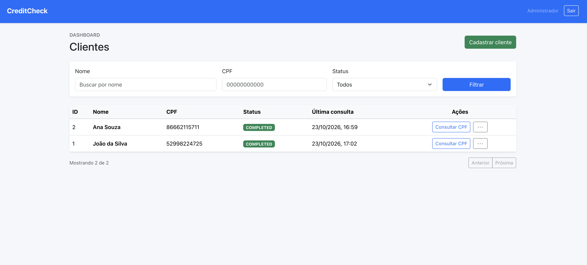

# CreditCheck Frontend

Frontend em React + TypeScript + Bootstrap para o painel administrativo do sistema CreditCheck. O projeto consome a API principal na porta 3000, autentica usuários no fluxo de login e permite cadastrar, filtrar, consultar e acompanhar clientes.

## Visão geral

A aplicação oferece:

- login administrativo com JWT
- listagem paginada de clientes
- filtros por nome, CPF e status
- cadastro de novos clientes
- ação de consulta CPF por cliente
- modal com informações detalhadas do cliente e histórico de transações
- atualização em tempo real via Socket.IO

## Screenshot



## Requisitos

- Node.js 18+
- npm
- API principal rodando em `http://localhost:3000`

## Como rodar

1. Instale as dependências:

```bash
npm install
```

2. Inicie o projeto em modo de desenvolvimento:

```bash
npm run dev -- --host 0.0.0.0
```

3. Abra no navegador:

```text
http://localhost:5173
```

## Login padrão

Para testar a aplicação, use:

- e-mail: `admin@creditcheck.local`
- senha: `Admin@12345`


## Arquitetura de integração

A aplicação foi configurada para conversar apenas com a API principal:

- REST: `http://localhost:3000`
- Socket.IO: `ws://localhost:3000`


